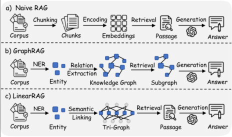
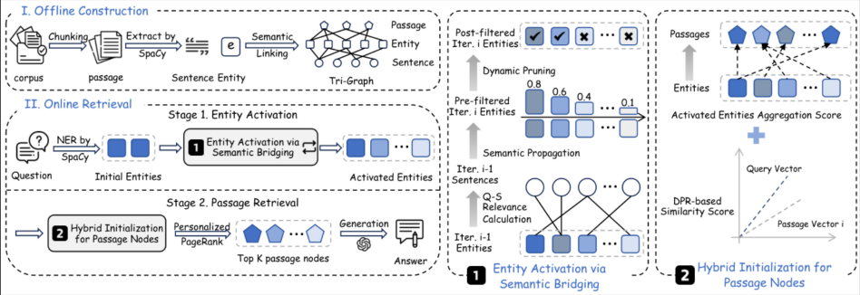
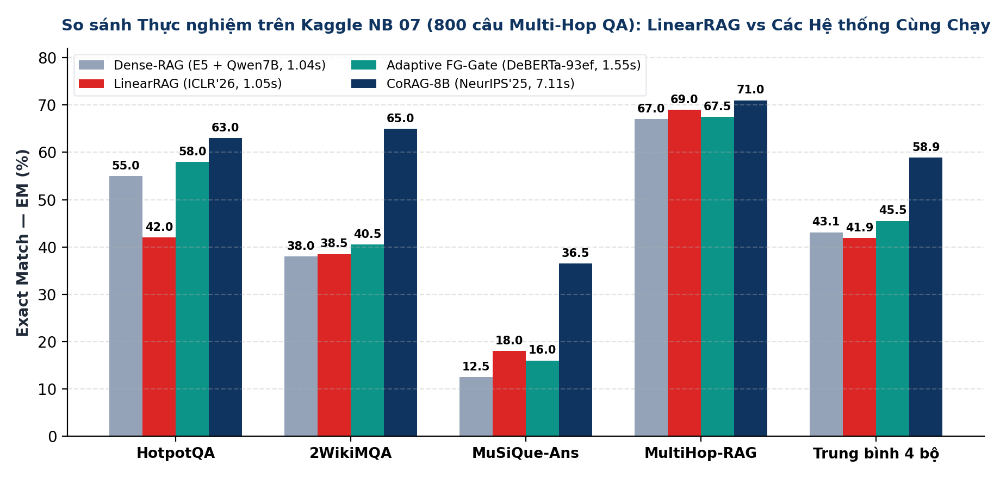
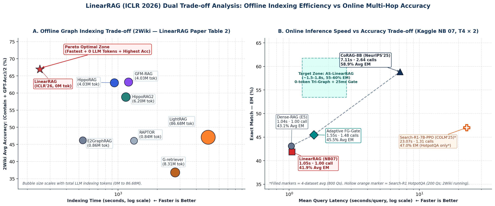

# Báo Cáo Chuyên Sâu: LinearRAG (ICLR 2026), Đối Chiếu SOTA & Phân Tích Trade-Off Đa Chiều

- **Paper gốc:** *LinearRAG: Linear Graph Retrieval Augmented Generation on Large-scale Corpora* — Luyao Zhuang et al. (Hong Kong Polytechnic University), **ICLR 2026** (`arXiv:2510.10114v4`)
- **Mã nguồn chính thức:** [DEEP-PolyU/LinearRAG](https://github.com/DEEP-PolyU/LinearRAG)
- **Thực nghiệm kiểm chứng của nhóm:** Kaggle `Tesla T4 × 2`, [Notebook 07 (`07_overnight_multihop_rag_systems.ipynb`)](../07_overnight_multihop_rag_systems.ipynb) · Script tạo notebook: [`scripts/build_overnight_suite_07.py`](../scripts/build_overnight_suite_07.py)
- **Phiên bản Word / Google Docs (nhúng hình chuẩn):** [Bao_Cao_LinearRAG_Full_CoHinh_GoogleDocs.docx](Bao_Cao_LinearRAG_Full_CoHinh_GoogleDocs.docx)
- **Tài liệu liên quan trong cùng repo:**
  - [Ma trận 10 Paper Multi-Hop RAG (2025–2026, A*/A + code)](multihop_rag_2025_2026_survey.md)
  - [Đánh giá 8 Benchmark & So sánh SOTA cho Fact-Grounding Classifier](eight_benchmark_sota_comparison.md)
  - [5 Nút Thắt Thực Nghiệm & Bản Đồ Research Gap (2024–2026)](bottlenecks_and_literature_gap.md)

---

## Tóm tắt Điều hành (Executive Summary)

1. **Đóng góp cốt lõi của LinearRAG (ICLR 2026):** Loại bỏ hoàn toàn bước dùng LLM trích xuất bộ ba quan hệ `(head, relation, tail)` khi dựng đồ thị tri thức (**`0` indexing LLM tokens**), thay bằng đồ thị phân cấp không quan hệ **Tri-Graph** (`Passage ↔ Sentence ↔ Entity`) kết hợp truy xuất trực tuyến 2 bước (*Local Semantic Bridging* + *Hybrid Personalized PageRank*). Trên `2WikiMultiHopQA` (Table 2 gốc), LinearRAG lập chỉ mục trong **`249.78s`** (**nhanh hơn `19.7×` LightRAG** và **`4.6×` HippoRAG2**), mở rộng tuyến tính lên kho **10M tokens** trong `3,084s` (0 token LLM) trong khi vẫn giữ nguyên văn bản gốc (lossless).
2. **Kết quả kiểm chứng đối đầu (Head-to-Head) trên Kaggle T4 × 2 (`800` câu / `4` kho gộp thực tế):** Ở chế độ tái cài đặt rút gọn trên Notebook 07 (`Qwen2.5-7B-Instruct` 4-bit NF4), LinearRAG dựng xong toàn bộ 4 đồ thị (`7,306` đoạn / `44,251` thực thể) trong **`175.56s`** với **`0` LLM tokens** và truy vấn cực nhanh (**`1.05s/câu`**, nhanh gấp **`6.8×` CoRAG-8B** và **`~22×` Search-R1**). Tuy nhiên, độ chính xác trung bình chỉ đạt **`41.9% EM / 47.5% F1`** — thắng `Dense-RAG` trên `MuSiQue-Ans` (`18.0% vs 12.5% EM`) và `MultiHop-RAG` (`69.0% vs 67.0% EM`), nhưng **thua `CoRAG-8B` tới `−17.0đ EM` trung bình** (`−26.5đ` trên `2Wiki`, `−18.5đ` trên `MuSiQue`) và thua `Dense-RAG (E5)` `−13.0đ EM` trên `HotpotQA`.
3. **Kiểm toán minh bạch giữa Paper gốc & Code Notebook 07:** Phân tích mã nguồn [`build_overnight_suite_07.py`](../scripts/build_overnight_suite_07.py) chỉ ra **3 điểm lược giản/lỗi cài đặt** trong `LinearRAGIndex` so với repo chính thức `DEEP-PolyU/LinearRAG` (chưa có tầng Sentence `M`, biến `bridge_e` ở dòng 473 chưa nối vào teleport/PPR, `alpha=0.5` thay vì `d=0.85`). Do đó cần tách bạch rõ **giới hạn cấu trúc nội tại của LinearRAG** (truy xuất tĩnh 1 lượt, nhiễu siêu nút relation-free, không có cổng kiểm chứng đủ ngữ cảnh) với **sai số cài đặt NB 07** cần chạy kiểm chứng lại bằng repo gốc.
4. **Khoảng trống Trade-off & Kiến trúc đề xuất (`AS-LinearRAG`):** LinearRAG thống trị đường biên **Offline Indexing Cost vs Graph Quality**, còn `CoRAG-8B` thống trị đường biên **Multi-Hop Accuracy** nhưng chậm gấp `6.8×`. Kết hợp **Tri-Graph 0-token của LinearRAG** + **Cổng kiểm chứng đủ ngữ cảnh 435M đã hiệu chỉnh (`25ms`, từ Fact-Grounding / FactCG)** + **2nd-Hop Conditional PPR** hứa hẹn mở ra điểm Pareto mới ở vùng **`~1.5–1.8s/câu`** với mức tăng **`+15–20đ EM`**.

---

## 1. Bối cảnh & Kiến trúc LinearRAG (ICLR 2026)

### 1.1. Ba thế hệ RAG & vấn đề của GraphRAG truyền thống

*Hình 1 (Nguồn: Figure 1, arXiv:2510.10114v4): Đối chiếu trực quan 3 thế hệ RAG — (a) Naive RAG, (b) GraphRAG trích xuất quan hệ bằng LLM, và (c) Relation-Free Tri-Graph của LinearRAG.*

Các hệ thống GraphRAG trước đây (*Microsoft GraphRAG, LightRAG, HippoRAG, HippoRAG2, GFM-RAG*) đều dựa vào LLM để trích xuất bộ ba quan hệ `(head, relation, tail)` trên từng đoạn văn bản. Bài báo LinearRAG chỉ ra **2 điểm nghẽn chí mạng**:
- **Chi phí lập chỉ mục khổng lồ & khó mở rộng:** Trên `2WikiMultiHopQA`, *LightRAG* tiêu tốn **`4,933.22s`** và **`86.68M` tokens LLM** (`35.52M` prompt + `51.16M` completion); *HippoRAG2* tốn **`1,147.01s`** và **`6.20M` tokens**. Trên kho `10M tokens` (*ATLAS-Wiki*), *HippoRAG* cần `13,815s` (~3.8 giờ) và `35.57M` tokens; *RAPTOR* cần `46,431s` (~12.9 giờ) và `19.44M` tokens.
- **Méo thông tin cục bộ & suy giảm Context Relevance:** Việc ép ngữ cảnh phức tạp thành bộ ba nguyên tử và tóm tắt cộng đồng làm rơi chi tiết (Table 4 gốc cho thấy *LightRAG* và *HippoRAG* bị rớt Context Relevance xuống chỉ còn **`41.3%–52.4%`**, thấp hơn cả *Vanilla RAG* `63.7%–89.9%`).

### 1.2. Cơ chế 2 giai đoạn của LinearRAG

*Hình 2 (Nguồn: Figure 3, arXiv:2510.10114v4): Giai đoạn I dựng Tri-Graph ngoại tuyến (0 token LLM) và Giai đoạn II truy xuất trực tuyến 2 bước (Local Semantic Bridging + Global Hybrid PPR).*

1. **Giai đoạn I — Offline Relation-Free Tri-Graph Construction (`0` LLM token):**
   - Tách từng đoạn văn thành các câu và dùng NER nhẹ (`spaCy en_core_web_sm`) rút trích thực thể.
   - Lưu cấu trúc đồ thị 3 tầng **`Passage ↔ Sentence ↔ Entity`** bằng hai ma trận thưa:
     - **Ma trận `C` (`Contain`):** liên kết `Passage ↔ Entity`.
     - **Ma trận `M` (`Mention`):** liên kết `Sentence ↔ Entity`.
   - Tính embedding dày đặc (mặc định `all-mpnet-base-v2`) cho câu và đoạn văn; **giữ nguyên 100% văn bản gốc** (không tóm tắt cộng đồng).
2. **Giai đoạn II — Online Two-Stage Linear Retrieval:**
   - **Bước 1 — Local Semantic Bridging (Kích hoạt thực thể cầu nối cục bộ):** Nhận diện thực thể trong câu hỏi, đo độ tương đồng ngữ nghĩa giữa câu hỏi và các câu chứa thực thể đó thông qua ma trận `M`, rồi lan truyền kích hoạt sang các thực thể lân cận (tối đa 4 vòng kèm ngưỡng cắt tỉa động) để bắt các thực thể cầu nối ẩn.
   - **Bước 2 — Global Importance Aggregation (Hybrid Personalized PageRank):** Chạy Personalized PageRank (`d = 0.85`) trên cấu trúc `Passage ↔ Entity` kết hợp giữa điểm thực thể đã kích hoạt từ Bước 1 và độ tương đồng trực tiếp câu hỏi–đoạn văn để xếp hạng và trả về `Top-K` đoạn văn gốc nguyên vẹn cho bộ sinh.

---

## 2. Toàn bộ Context Kết quả & SOTA Đối chiếu trong Paper Gốc (`arXiv:2510.10114v4`)

### 2.1. Table 1 Gốc — Đối chiếu 16 Phương pháp trên 4 Benchmark (Backbone chính: `all-mpnet-base-v2` + `GPT-4o-mini`)

> **Lưu ý metric:** Paper gốc chấm **`Contain-Acc.`** (đáp án chuẩn nằm trong câu trả lời sinh ra) và **`GPT-Acc.`** (LLM-as-a-Judge bằng GPT), **không** dùng Exact Match chuỗi chặt (`EM`). Trên bộ *Medical (GraphRAG-Bench)* chỉ báo cáo `GPT-Acc.` vì đáp án dạng mô tả dài.

| Nhóm | Phương pháp | HotpotQA *(Contain / GPT-Acc)* | 2WikiMQA *(Contain / GPT-Acc)* | MuSiQue *(Contain / GPT-Acc)* | Medical *(GPT-Acc)* |
| :--- | :--- | :---: | :---: | :---: | :---: |
| **Zero-shot LLM** | `Llama-8B` | 31.10 / 27.30 | 33.60 / 16.20 | 7.40 / 8.10 | 27.31 |
| | `Llama-13B` | 24.20 / 16.80 | 21.90 / 10.50 | 3.30 / 4.40 | 28.86 |
| | `GPT-3.5-turbo` | 33.40 / 43.20 | 28.70 / 31.00 | 10.30 / 21.90 | 45.60 |
| | `GPT-4o-mini` | 38.90 / 40.20 | 36.30 / 31.40 | 13.60 / 15.80 | 42.10 |
| **Vanilla RAG** | `Retrieval (Top-1)` | 46.30 / 49.10 | 36.60 / 31.70 | 17.80 / 21.10 | 48.01 |
| | `Retrieval (Top-3)` | 53.00 / 56.00 | 44.90 / 39.70 | 25.10 / 27.50 | 59.07 |
| | `Retrieval (Top-5)` | 55.70 / 58.60 | 48.60 / 43.00 | 26.10 / 29.60 | 61.68 |
| **GraphRAG** | `KGP` | 61.50 / 60.90 | 31.60 / 30.00 | 25.60 / 30.10 | 54.22 |
| | `G-retriever` | 42.20 / 40.60 | 46.60 / 27.10 | 14.40 / 15.50 | 50.36 |
| | `RAPTOR` | 55.90 / 58.30 | 50.10 / 42.10 | 23.30 / 27.40 | 55.75 |
| | `E2GraphRAG` | 61.00 / 63.90 | 54.30 / 38.10 | 23.80 / 26.20 | 58.00 |
| | `LightRAG` | 60.30 / 59.50 | 55.20 / 39.00 | 27.40 / 28.60 | 54.36 |
| | `HippoRAG` | 57.00 / 59.30 | 66.10 / 59.90 | 29.30 / 24.10 | 55.04 |
| | `GFM-RAG` | 62.70 / 65.60 | 66.80 / 59.60 | 29.90 / 34.60 | 56.07 |
| | `HippoRAG2` | 62.90 / 64.30 | 62.70 / 55.00 | 31.00 / 35.00 | 60.77 |
| **Đề xuất** | **`LinearRAG (ICLR'26)`** | **64.30 / 66.50** | **70.20 / 63.70** | **33.90 / 37.00** | **63.72** |

### 2.2. Table 2 & Table 6 Gốc — Chi phí Lập chỉ mục, Tiêu thụ Token & Khả năng Mở rộng

**A. Hiệu năng & Chi phí trên `2WikiMultiHopQA` (RTX 4090 D 24GB — Table 2):**

| Phương pháp | Thời gian Indexing (s) ↓ | Độ trễ Retrieval TB (s) ↓ | Prompt Tokens ($\times 10^6$) ↓ | Completion Tokens ($\times 10^6$) ↓ | Tổng Tokens ($\times 10^6$) ↓ | 2Wiki Avg Acc (%) ↑ |
| :--- | ---: | ---: | ---: | ---: | ---: | ---: |
| `G-retriever` | 2,745.94 | 11.487 | 6.05 | 2.26 | 8.31 | 36.85 |
| `RAPTOR` | 1,323.57 | 0.062 | 0.81 | 0.03 | 0.84 | 46.10 |
| `E2GraphRAG` | 534.60 | **0.053** | 0.78 | 0.08 | 0.86 | 46.20 |
| `LightRAG` | 4,933.22 | 10.963 | 35.52 | 51.16 | 86.68 | 47.10 |
| `HippoRAG` | 936.00 | 1.461 | 3.05 | 0.98 | 4.03 | 63.00 |
| `GFM-RAG` | 1,202.77 | 1.211 | 3.05 | 0.98 | 4.03 | 63.20 |
| `HippoRAG2` | 1,147.01 | 1.694 | 4.98 | 1.22 | 6.20 | 58.85 |
| **`LinearRAG`** | **249.78** | 0.093 | **0** | **0** | **0** | **66.95** |

**B. Khả năng mở rộng trên kho lớn `ATLAS-Wiki` (5M & 10M tokens — Table 6):**

| Quy mô kho | Phương pháp | Thời gian Indexing (s) ↓ | Tổng LLM Tokens ($\times 10^6$) ↓ | Tốc độ so với LinearRAG |
| :--- | :--- | ---: | ---: | :---: |
| **5M tokens** | `RAPTOR` | 18,033.75 | 8.39 *(7.43P + 0.96C)* | Chậm hơn `12.8×` |
| | `HippoRAG` | 6,032.46 | 17.62 *(13.94P + 3.68C)* | Chậm hơn `4.3×` |
| | **`LinearRAG`** | **1,409.95** | **0** | **`1.0×` (Baseline nhanh nhất)** |
| **10M tokens** | `RAPTOR` | 46,430.96 | 19.44 *(16.62P + 2.82C)* | Chậm hơn `15.1×` |
| | `HippoRAG` | 13,815.00 | 35.57 *(28.04P + 7.53C)* | Chậm hơn `4.5×` |
| | **`LinearRAG`** | **3,084.38** | **0** | **`1.0×` (Tăng ~`2.19×` khi kho gấp đôi)** |

### 2.3. Table 4 & Table 5 Gốc — Chất lượng Truy xuất (Lossless Relevance) & Ảnh hưởng Embedding Backbone

**A. Table 4 — Retrieval Recall & Context Relevance (%) trên 4 nhóm câu hỏi:**

| Phương pháp | Fact Retrieval *(Rec / Rel)* | Complex Reasoning *(Rec / Rel)* | Contextual *(Rec / Rel)* | Creative Generation *(Rec / Rel)* |
| :--- | :---: | :---: | :---: | :---: |
| `Vanilla RAG (Top-5)` | 86.24 / 63.71 | 84.97 / **84.11** | 84.14 / **89.94** | 44.88 / 58.73 |
| `RAPTOR` | 85.40 / 69.38 | **89.70** / 53.20 | 88.86 / 58.73 | 72.70 / 52.71 |
| `E2GraphRAG` | 87.84 / 69.74 | 87.08 / 62.67 | **89.17** / 71.63 | 60.26 / 35.84 |
| `LightRAG` | 80.32 / 41.27 | 82.91 / 42.79 | 85.71 / 43.11 | 81.34 / 45.17 |
| `HippoRAG` | 87.25 / 52.44 | 83.80 / 42.19 | 83.46 / 49.13 | 81.66 / 45.03 |
| `GFM-RAG` | **90.08** / 57.90 | 85.03 / 33.06 | 78.62 / 40.14 | 83.51 / 22.87 |
| **`LinearRAG`** | 88.86 / **86.09** | 87.03 / 81.58 | 89.13 / 87.89 | **89.08** / **72.74** |

**B. Table 5 — Nhạy cảm với Sentence Embedding Backbone trong chính LinearRAG:**

| Embedding Backbone | HotpotQA *(Contain / GPT)* | 2Wiki *(Contain / GPT)* | MuSiQue *(Contain / GPT)* | Medical *(GPT-Acc)* |
| :--- | :---: | :---: | :---: | :---: |
| `all-mpnet-base-v2` *(mặc định)* | 64.30 / 66.50 | **70.20** / 63.70 | **33.90** / **37.00** | 63.72 |
| `all-MiniLM-L6-v2` | 64.20 / 64.90 | 69.50 / 62.60 | 32.80 / 36.90 | 62.32 |
| `bge-large-en-v1.5` | 66.20 / 67.60 | 69.80 / **63.90** | 31.80 / 35.20 | 64.45 |
| `e5-large-v2` | **66.80 / 68.30** | 69.90 / 63.10 | 31.70 / 36.50 | **65.42** |

> **Nhận xét quan trọng từ Table 5:** Đổi sang `e5-large-v2` giúp LinearRAG tăng ngay `+2.5đ Contain / +1.8đ GPT-Acc` trên `HotpotQA` và `+1.7đ` trên `Medical`, nhưng trên `MuSiQue` vẫn bị trần quanh **`31.7%–37.0%`** — khẳng định **trần độ chính xác trên câu hỏi 3–4 bước ẩn cầu nối là giới hạn cấu trúc của đồ thị 1 lượt, không chỉ do encoder**.

---

## 3. Thực nghiệm Kiểm chứng trên Kaggle T4 × 2 (Notebook 07) & Đối chiếu SOTA Ngoài Paper

### 3.1. Thiết lập kiểm soát công bằng (`800` câu hỏi / `7,306` đoạn văn gộp thực tế)

Toàn bộ các hệ thống trong [Notebook 07](../07_overnight_multihop_rag_systems.ipynb) (`seed = 42`, `n = 200`/bộ) tìm kiếm trên **cùng kho đoạn văn gộp cỡ lớn theo từng tập dữ liệu** (không dùng 10 đoạn oracle cục bộ) và ba hệ thống đầu dùng chung bộ sinh **`Qwen/Qwen2.5-7B-Instruct` (4-bit NF4)**, cùng system prompt và top-5 passages:

| Dataset (`n = 200`) | Số tài liệu kho gộp | Số thực thể NER (`LinearRAG`) | Thời gian index `E5-base-v2` | Thời gian index `LinearRAG` | LLM Tokens Indexing |
| :--- | ---: | ---: | ---: | ---: | :---: |
| `HotpotQA` (distractor val) | 1,977 | 13,323 | 19.47s | 49.46s | **0** |
| `2WikiMultiHopQA` (dev) | 1,431 | 8,393 | 10.42s | 27.29s | **0** |
| `MuSiQue-Ans` (dev) | 3,289 | 18,148 | 27.54s | 73.55s | **0** |
| `MultiHop-RAG` (news non-null) | 609 | 4,387 | 17.43s | 25.26s | **0** |
| **Tổng cộng** | **7,306** | **44,251** | **74.86s** | **175.56s** | **0** |

### 3.2. Bảng Đối chiếu Head-to-Head (Notebook 07 + Paper Gốc + External SOTA 2025–2026)

*Hình 3: So sánh Exact Match (%) giữa Dense-RAG, LinearRAG (NB 07), Adaptive-FG-Gate và CoRAG-8B trên cùng 800 câu Multi-Hop QA (Kaggle T4 × 2).*

| Dataset (`n = 200`) | `Dense-RAG` *(E5 + Qwen7B)* EM / F1 / Rec | **`LinearRAG` *(NB07 · Qwen7B)*** EM / F1 / Contain / Rec | `Adaptive-FG-Gate` *(DeBERTa-93ef + Qwen7B)* EM / F1 / Rec (Calls) | `CoRAG-8B` *(NeurIPS'25, L=3)* EM / F1 / Rec (Calls) | `Search-R1-7B` *(COLM'25 PPO)* EM / F1 / Rec (Calls) | `LinearRAG` gốc *(Table 1 · GPT-4o-mini)* | External SOTA Published *(2024–2026)* |
| :--- | :---: | :---: | :---: | :---: | :---: | :---: | :--- |
| **HotpotQA** | 55.0 / 63.5 / **88.0%** | **42.0 / 50.8 / 50.0 / 74.0%** | 58.0 / 67.7 / 83.8% *(1.16)* | **63.0 / 75.0** / 83.5% *(2.69)* | 47.0 / 56.1 / 56.5% *(1.31 · 23.07s)* | 64.3% Contain · 66.5% GPT-Acc | `Beam Retrieval`: 72.7 EM / 85.0 F1 · `HippoRAG2 (70B)`: 75.5 F1 · `HopRAG`: 61.3 EM / 78.3 F1 |
| **2WikiMQA** | 38.0 / 44.5 / 75.3% | **38.5 / 43.2 / 41.0 / 67.6%** | 40.5 / 47.0 / 77.6% *(1.50)* | **65.0 / 71.9** / **84.6%** *(2.86)* | *đang chạy (160/200)* | 70.2% Contain · 63.7% GPT-Acc | `SynPlanResearch-R1`: 82.1% EM · `SAGE`: 82.9% F1 · `CoRAG (BoN-8)`: 72.5 EM / 77.3 F1 |
| **MuSiQue-Ans** | 12.5 / 20.9 / 60.1% | **18.0 / 26.7 / 24.5 / 57.0%** | 16.0 / 26.1 / 63.1% *(1.53)* | **36.5 / 45.5** / **70.8%** *(2.52)* | *chờ hoàn tất* | 33.9% Contain · 37.0% GPT-Acc | `SLEA-RL`: 77.2% EM / 81.3% F1 · `HopRAG`: 39.1 EM / 53.0 F1 · `HippoRAG2 (70B)`: 48.6 F1 |
| **MultiHop-RAG** | 67.0 / 67.2 / **60.4%** | **69.0 / 69.2 / 69.0 / 55.0%** | 67.5 / 67.7 / 55.2% *(1.71)* | **71.0 / 72.2** / 49.6% *(2.47)* | *chờ hoàn tất* | *(không đo ở Table 1)* | `SPA`: 88.36% Acc |
| **TB 4 bộ** | **43.1 / 49.0** (`70.9%` Rec · `1.04s`) | **41.9 / 47.5** (`63.4%` Rec · **`1.05s`** · `1.0` call) | **45.5 / 52.1** (`69.9%` Rec · `1.55s` · `1.48` calls) | **58.9 / 66.2** (`72.1%` Rec · `7.11s` · `2.64` calls) | HotpotQA: `47.0 EM` (`23.07s`) | — | **`LinearRAG` thua `CoRAG` `−17.0đ EM` nhưng nhanh gấp `6.8×`** |

### 3.3. Kiểm toán Minh bạch (Implementation Audit — Notebook 07 vs Repo Gốc `DEEP-PolyU/LinearRAG`)

Để kết quả trên GitHub hoàn toàn trung thực về mặt khoa học, cần ghi rõ **3 sai khác kỹ thuật** khi rà soát class `LinearRAGIndex` trong [`scripts/build_overnight_suite_07.py` (L428–L498)](../scripts/build_overnight_suite_07.py#L428-L498) so với thuật toán gốc trong bài báo:

| Hạng mục | Paper & Repo gốc `DEEP-PolyU/LinearRAG` | Bản tái cài đặt rút gọn trong NB 07 (`build_overnight_suite_07.py`) | Tác động ước tính lên điểm NB 07 |
| :--- | :--- | :--- | :--- |
| **1. Cấu trúc đồ thị** | **Tri-Graph 3 tầng** (`Passage ↔ Sentence ↔ Entity`, gồm cả ma trận `C` và ma trận câu `M` + sentence embeddings) | **Bipartite 2 tầng** (`Entity ↔ Passage`, chỉ có 1 ma trận `self.B`, chưa có tầng Sentence `M`) | Mất độ mịn semantic matching ở cấp câu (trường hợp đoạn dài chứa nhiều thực thể lẫn lộn). |
| **2. Local Semantic Bridging** | Lan truyền kích hoạt thực thể qua tầng câu tối đa **4 vòng** kèm cắt tỉa ngưỡng động | Dòng [`L473`](../scripts/build_overnight_suite_07.py#L473) tính biến `bridge_e = P_d2e.T @ local_p * ent_idf` nhưng **chưa đưa vào `teleport` hay vòng PPR** (unused variable) | **Đáng kể:** Hạn chế khả năng kích hoạt thực thể cầu nối 2-hop ngay từ bước khởi tạo trước khi chạy PPR. |
| **3. Siêu tham số & Cắt văn bản** | PPR damping `d = 0.85` (`alpha = 0.15`), đầy đủ đoạn văn & thực thể | PPR dùng `alpha = 0.5` (damping `0.5`, ít lan truyền xa hơn); NER cắt `text[:1200]` tối đa 25 thực thể ([`L412–L423`](../scripts/build_overnight_suite_07.py#L412-L423)); embed cắt `text[:800]` ([`L456`](../scripts/build_overnight_suite_07.py#L456)) | Thu hẹp bán kính lan truyền PPR và cắt bớt thực thể cuối đoạn trên các bài dài. |

> **Kết luận kiểm toán:** Mức tụt `−13.0đ EM` trên `HotpotQA` so với `Dense-RAG (E5)` có sự cộng hưởng của **(a) backbone `all-mpnet-base-v2` yếu hơn `E5-base-v2`** và **(b) bản rút gọn 2 tầng + bug `bridge_e` của NB 07**. Tuy nhiên, ngay cả trên **Table 1 & Table 5 của chính tác giả với `GPT-4o-mini` và `e5-large-v2`**, LinearRAG cũng chỉ đạt **`31.7%–33.9% Contain-Acc`** trên `MuSiQue` (so với `CoRAG` và các phương pháp iterative/RL vượt trội hẳn về Recall trên câu hỏi ẩn cầu nối) — xác nhận **trần hiệu năng 1-lượt (Single-Shot PPR Blindness)** là điểm yếu cấu trúc có thật của LinearRAG.

---

## 4. Phân Tích Trade-Off Toàn Diện: LinearRAG vs Các Paper & Phương Pháp So Sánh

*Hình 4: Hai đường biên đánh đổi cốt lõi của LinearRAG — (A) Offline Indexing Time & LLM Tokens vs 2Wiki Accuracy theo Table 2 gốc; (B) Online Latency vs Multi-Hop EM (%) trên Kaggle NB 07 cùng vùng mục tiêu của kiến trúc đề xuất `AS-LinearRAG`.*

### 4.1. Ma trận Trade-Off Đa Chiều (LinearRAG vs 10 Họ Phương pháp Đối chiếu)

| Phương pháp / Paper | Họ kiến trúc | Chi phí Indexing *(Time & LLM Tokens)* | Chi phí Training / RL | Độ trễ Online *(Latency / Calls)* | 2-Hop QA *(Hotpot / 2Wiki)* | 3–4 Hop ẩn cầu nối *(MuSiQue)* | Giữ nguyên ngữ cảnh *(Lossless)* | Chống nhiễu Hub / Quan hệ phức tạp | Kiểm chứng đủ ngữ cảnh / Abstain | Đánh đổi cốt lõi (Trade-off Summary) |
| :--- | :--- | :---: | :---: | :---: | :---: | :---: | :---: | :---: | :---: | :--- |
| **`LinearRAG`** *(ICLR 2026)* | Relation-Free Tri-Graph + 1-Shot PPR | **Rất thấp** (`250s`, **`0` tok**; 10M tok chỉ `3,084s`) | **0** *(Training-free)* | **Rất nhanh** (`0.093s` ret · `1.05s` E2E · `1.0` call) | **Tốt** *(Paper: 64.3/70.2 Contain; NB07: 42.0/38.5 EM)* | **Thấp–TB** *(Paper: 33.9 Contain; NB07: 18.0 EM)* | **Có** *(Rel `86–88%`)* | **Yếu** *(Relation-free hub pollution)* | **Không** | **Đổi khả năng suy luận lặp & cạnh có nhãn quan hệ** lấy **0 token lập chỉ mục, tốc độ tuyến tính & giữ nguyên đoạn gốc**. |
| **`Dense-RAG` (`E5-base-v2`)** | Single-Shot Dense Vector | **Thấp nhất** (`75s`, **`0` tok**) | **0** *(Pretrained)* | **Nhanh nhất** (`1.04s` E2E · `1.0` call) | **Khá** *(NB07: 55.0 / 38.0 EM)* | **Rất thấp** *(NB07: 12.5 EM)* | **Có** *(Rel `64–90%`)* | **Trung bình** *(không lan truyền đồ thị)* | **Không** | Đơn giản nhất, mạnh ở 1–2 hop trùng ngữ nghĩa (`HotpotQA`), nhưng **mù hoàn toàn cầu nối đa bước (`MuSiQue` 12.5%)**. |
| **`LightRAG`** *(2024/2025)* | LLM-KG + Dual-Level Summary | **Rất cao** (`4,933s`, **`86.68M` tok** — đắt `∞×`) | **0** | **Chậm** (`10.96s` ret riêng lẻ) | **TB** *(Paper: 60.3 / 55.2 Contain)* | **Thấp** *(Paper: 27.4 Contain)* | **Không** *(Tóm tắt mất chi tiết; Rel `41–43%`)* | **Khá** *(có quan hệ LLM)* | **Không** | Tốn gấp **20× thời gian** & **86.7M tokens** so với LinearRAG nhưng độ chính xác & độ liên quan đều **thua toàn diện** trên QA đa bước. |
| **`HippoRAG` / `HippoRAG2`** *(NeurIPS'24 / ICML'25)* | LLM OpenIE KG + PPR + Passage Memory | **Cao** (`936–1,147s`, `4.0–6.2M` tok; 10M tok: `35.6M` tok) | **0** | **TB** (`1.46–1.69s` ret riêng lẻ) | **Rất tốt** *(Paper: 62.9/62.7; 70B: 75.5/71.0 F1)* | **Khá** *(Paper: 31.0 Contain; 70B: 48.6 F1)* | **Có** *(HippoRAG2 có passage node)* | **Tốt** *(cạnh OpenIE rõ quan hệ)* | **Không** | Đổi **`4–6M` tokens indexing** & **`15–18×` retrieval latency** so với LinearRAG để có **đồ thị giàu quan hệ**, mạnh nhất khi ghép LLM 70B. |
| **`GFM-RAG`** *(2025)* | OpenIE KG + Pretrained GNN Retriever | **Cao** (`1,203s`, `4.03M` tok) | **Có** *(Train GNN trên KG)* | **TB** (`1.21s` ret) | **Tốt** *(Paper: 62.7 / 66.8 Contain)* | **TB–Khá** *(Paper: 29.9 Contain)* | **Kém** *(Rel `23–58%`)* | **Tốt** *(GNN lọc đường đi)* | **Không** | Cần vừa tốn OpenIE LLM tokens vừa phải train GNN; hiệu năng tổng vẫn sát hoặc thấp hơn LinearRAG trên Table 1–2. |
| **`RAPTOR` / `KET-RAG`** *(ICLR'24 / KDD'25)* | Tree Summary / Skeleton-Bipartite KG | **TB–Cao** (`1,324s`, `0.84M` tok; 10M tok: `46,431s`) | **0** | **Cực nhanh** (`0.062s` ret) | **TB** *(RAPTOR: 55.9/50.1)* | **Thấp–TB** *(RAPTOR: 23.3)* | **Một phần** *(tóm tắt cụm)* | **TB** | **Không** | Truy xuất nhanh tương đương LinearRAG nhưng vẫn mất chi phí LLM tạo cây tóm tắt / skeleton và rớt Relevance ở mức `53–69%`. |
| **`Adaptive-FG-Gate`** *(NB07: DeBERTa-93ef + E5 + Qwen7B)* | Dense + Calibrated 435M Sufficiency Gate + Conditional Hop-2 | **Thấp nhất** (`75s`, **`0` tok**) | **Nhẹ** *(Fine-tune DeBERTa 435M)* | **Nhanh** (`1.55s` E2E · **`1.48` calls** · gate `25ms`) | **Khá–Tốt** *(NB07: 58.0 / 40.5 EM)* | **Thấp** *(NB07: 16.0 EM)* | **Có** | **Khá** | **Mạnh** *(AUROC `0.88–0.90`, chặn `96.3%` null)* | Chỉ tốn thêm **`+0.50s`** so với Dense/LinearRAG nhưng **tăng `+3.6đ EM` trung bình (`+16đ` vs LinearRAG trên HotpotQA)** và có sẵn tín hiệu từ chối khi thiếu chứng cứ. |
| **`CoRAG-8B`** *(NeurIPS 2025)* | Iterative Chain-of-Retrieval SFT (Llama-3.1-8B, `L=3`) | **Thấp nhất** (`75s`, **`0` tok**) | **Trung bình–Cao** *(Rejection sampling + SFT 8B)* | **Chậm** (`7.11s` E2E · `2.64` calls — chậm `6.8×`) | **Xuất sắc** *(NB07: **63.0 / 65.0 EM**)* | **Rất tốt** *(NB07: **36.5 EM**, `70.8%` Rec)* | **Có** | **Rất tốt** *(phân rã sub-query tường minh)* | **Yếu** *(luôn trả lời, không đo abstention)* | **Đổi tốc độ chậm hơn `6.8×` & chi phí SFT 8B** để lấy **bước nhảy `+17.0đ EM` trung bình** (`+26.5đ` 2Wiki, `+18.5đ` MuSiQue) so với LinearRAG. |
| **`Search-R1-7B-PPO`** *(COLM 2025)* | RL Agentic Search (`<think>/<search>`) | **Thấp nhất** (`75s`, **`0` tok**) | **Rất cao** *(PPO/GRPO RL 7B)* | **Rất chậm** (`23.07s` E2E HotpotQA — chậm **`22×`**) | **Trung bình** *(NB07 HotpotQA: `47.0 EM`, Rec `56.5%`)* | **Thấp–TB** *(Paper: `23.05 EM`)* | **Có** | **Kém ổn định** *(dừng sớm `1.31` calls)* | **Không** | Đổi **chi phí train RL rất lớn** & **độ trễ `23s/câu`** do chuỗi `<think>` dài, nhưng trên NB 07 HotpotQA bị **dừng search quá sớm** nên thua cả `Dense-RAG`, `Adaptive-FG-Gate` và `CoRAG`. |
| **`DeepResearcher` / `DeepRAG`** *(EMNLP'25 / ICLR'26)* | End-to-End RL / MDP Dynamic Retrieval | **Thấp** *(Web / Dense index)* | **Rất cao** *(RL trên 7B/8B)* | **Chậm** *(nhiều lượt web/LLM)* | **Khá** *(DeepRAG: 39.1/46.5 EM; DeepRes: 52.8/59.7 F1)* | **TB** *(DeepRes: 27.1 F1 OOD)* | **Có** | **Tốt** | **Một phần** *(DeepRAG quyết định nội tại vs tìm kiếm)* | Mạnh ở môi trường mở (open web / OOD Bamboogle), nhưng đòi hỏi training RL đắt đỏ và latency cao hơn nhiều lần đồ thị 1 lượt. |
| **`Provence`** *(ICLR 2025 — Bổ trợ Pruning)* | Sentence-Level Context Pruner + Reranker | **0** *(Dùng online)* | **Trung bình** *(Trained DeBERTa-v3)* | **Nhanh–TB** (`21–397ms` tùy số doc) | **Bổ trợ** *(Pairwise Hotpot `89.5%`, 2Wiki `78.4%`)* | **Bổ trợ** *(Pairwise `81.7%`)* | **Nén mất `48–88%`** *(Cắt nhầm câu cầu nối nếu tỉa mù)* | **Yếu trên IIRC** *(AUROC `0.349`)* | **Không** *(Threshold collapse)* | Chỉ nên kích hoạt **có điều kiện khi vượt 512 token** (`2Wiki` `+8.35đ F1`); nếu bật đại trà sẽ phá hủy câu cầu nối multi-hop. |

---

### 4.2. Bốn Đường Biên Đánh Đổi (Pareto Frontiers) Quan Trọng Nhất

#### Trade-off 1 — *Offline Indexing Cost vs Graph Expressiveness* (Chi phí dựng kho vs Độ giàu quan hệ)
- **LinearRAG thắng tuyệt đối về kinh tế dựng kho:** Trên `2Wiki`, giảm **`100%` chi phí token LLM** (`86.68M → 0` so với `LightRAG`; `6.20M → 0` so với `HippoRAG2`) và rút thời gian lập chỉ mục xuống `249.78s` (trên 10M tokens chỉ `3,084s` so với `13,815s` của HippoRAG và `46,431s` của RAPTOR).
- **Cái giá phải trả:** Mất cạnh có nhãn quan hệ `(subject, predicate, object)` khiến đồ thị nhạy cảm với **nhiễu siêu nút (Hub Pollution)** — các thực thể xuất hiện dày đặc như quốc gia, năm, tổ chức lớn dễ hút xác suất PageRank sang các tài liệu cùng thực thể nhưng sai quan hệ ngữ nghĩa.

#### Trade-off 2 — *Online Latency vs Multi-Hop Accuracy* (Hiệu suất định lượng trên Kaggle NB 07)
Đo trực tiếp trên cùng `800` câu hỏi (cùng phần cứng `Tesla T4 × 2`):

| Hệ thống (NB 07) | Latency TB (s) | Calls TB | Avg EM (%) | Avg F1 (%) | Hiệu suất `EM / giây` | Chi phí biên so với `LinearRAG` (`ΔLatency` → `ΔEM`) |
| :--- | ---: | ---: | ---: | ---: | ---: | :--- |
| **`LinearRAG` (NB07)** | **1.05s** | 1.00 | 41.9% | 47.5% | **39.9** | Baseline (`0s` → `0đ`) |
| **`Dense-RAG` (E5)** | **1.04s** | 1.00 | 43.1% | 49.0% | **41.5** | `−0.01s` → `+1.2đ EM` *(thắng ở HotpotQA, thua ở MuSiQue `−5.5đ`)* |
| **`Adaptive-FG-Gate`** | **1.55s** | 1.48 | 45.5% | 52.1% | 29.4 | **`+0.50s`** → **`+3.6đ EM`** (`+7.2đ EM` cho mỗi giây bỏ thêm) |
| **`CoRAG-8B` (NeurIPS'25)** | 7.11s | 2.64 | **58.9%** | **66.2%** | 8.3 | **`+6.06s`** → **`+17.0đ EM`** (`+2.8đ EM` cho mỗi giây bỏ thêm) |
| **`Search-R1-7B` (HotpotQA)** | 23.07s | 1.31 | 47.0%* | 56.1%* | 2.0* | **`+22.08s`** → **`+5.0đ EM`** trên HotpotQA *(hiệu suất biên kém nhất: `+0.23đ EM/s`)* |

- **Điểm đứt gãy rõ nhất (Speed–Accuracy Chasm):** Từ `1.05s` (`LinearRAG`) lên `7.11s` (`CoRAG`) là khoảng nhảy **`6.8×` độ trễ** để đổi lấy **`+17.0đ EM`**. Không có phương pháp đơn lẻ nào hiện tại nằm ở vùng ngọt **`1.5–2.0s` nhưng đạt `55–60% EM`**.

#### Trade-off 3 — *Static 1-Shot Graph Propagation vs Dynamic Multi-Turn Decomposition*
- **Khi câu hỏi đã lộ đủ thực thể gốc hoặc cần bắc cầu ngắn trong kho tin tức (`MultiHop-RAG`):** LinearRAG đạt **`69.0% EM`** (vượt Dense-RAG `67.0%`, bám sát CoRAG `71.0%`) chỉ với `1.28s` thay vì `8.50s` của CoRAG.
- **Khi câu hỏi ẩn hoàn toàn thực thể trung gian (`2Wiki`, `MuSiQue` 3–4 bước):** Vector câu hỏi gốc không chứa tên thực thể hop-2, nên lan truyền PPR 1 lượt bị phân tán; trong khi `CoRAG` tách sub-query từng bước giúp Recall nhảy vọt từ `67.6% → 84.6%` (`2Wiki`) và `57.0% → 70.8%` (`MuSiQue`).
- **Nghịch lý của RL Search (`Search-R1`):** Tự chủ bằng RL không tự động tốt hơn nếu mô hình mắc bệnh quá tự tin nội tại — trên `HotpotQA`, Search-R1 chỉ gọi search `1.31` lượt/câu (Recall rơi xuống `56.5%`) nhưng tốn `23.07s` sinh `<think>`, tức **vừa chậm hơn CoRAG `3.3×`, vừa thua CoRAG `−16.0đ EM`**.

#### Trade-off 4 — *Lossless Context vs Compression / Summarization*
- **LinearRAG & Dense-RAG & CoRAG** giữ nguyên đoạn văn gốc → tránh sụp đổ Context Relevance (`86–88%` ở LinearRAG vs `41–43%` ở LightRAG).
- **Khi ghép thêm Sufficiency Verifier 512-token (như DeBERTa-v3-large):** Giữ nguyên quá nhiều đoạn dài sẽ gây cắt cụt cứng (`95.9%` trên `2Wiki`), nhưng dùng pruner single-hop như **Provence (ICLR'25)** cắt đồng loạt lại tạo ra nghịch lý *Bridge-Sentence Destruction* (rớt `−2.9` đến `−9.2đ AUROC` trên 5/8 tracks). Do đó cần **Length-Gated & Bridge-Aware Pruning** thay vì nén mù.

---

### 4.3. Ma trận Khuyến nghị Chọn Kiến trúc theo Kịch bản Thực tế

| Kịch bản triển khai / Yêu cầu ưu tiên | Lựa chọn tối ưu hiện tại | Lý do trực tiếp từ Trade-off |
| :--- | :--- | :--- |
| **Kho tài liệu cực lớn (5M–100M+ tokens), ngân sách Indexing = \$0, cần độ trễ `< 1.5s`** | **`LinearRAG`** *(nâng backbone sang `E5-large-v2` / `BGE-M3`)* | 0 LLM indexing tokens, mở rộng tuyến tính (`3,084s` / 10M tokens), retrieval `0.093s`, giữ văn bản lossless. |
| **Bài toán 1–2 hop đơn giản, cần triển khai nhanh nhất** | **`Dense-RAG` (`E5` / `BGE`)** | Index nhanh nhất (`75s`), `HotpotQA` Recall `88%` / EM `55%` trong `0.95s`. |
| **Hệ thống Production cần độ tin cậy cao, có câu hỏi không trả lời được (`null_query` / unanswerable) & latency `< 2s`** | **`Adaptive-FG-Gate`** *(DeBERTa-93ef calibrated + E5)* | Chỉ tăng `+0.5s` (`1.48` calls), chặn `96.3%` câu hỏi rỗng, `+3.6đ EM` so với LinearRAG & `+2.4đ` so với Dense-RAG. |
| **Ưu tiên tối đa độ chính xác Multi-Hop 2–4 bước, chấp nhận latency `6–9s/câu` và GPU chạy LLM 8B** | **`CoRAG-8B` (NeurIPS'25)** | Dẫn đầu tuyệt đối `58.9% EM / 66.2% F1` (vượt LinearRAG `+26.5đ` trên 2Wiki, `+18.5đ` trên MuSiQue). |
| **Kho nhỏ–trung bình cần suy luận quan hệ phức tạp & chấp nhận trả phí OpenIE LLM indexing** | **`HippoRAG2` (ICML'25)** | Cạnh OpenIE rõ quan hệ, kết hợp LLM mạnh đạt F1 cao (`75.5` HotpotQA / `71.0` 2Wiki). |
| **Hướng nghiên cứu mới (Mục tiêu vượt Pareto hiện tại)** | **`AS-LinearRAG`** *(Đề xuất ở Mục 5)* | Ghép đồ thị 0-token LinearRAG + Cổng sufficiency 25ms + 2nd-hop PPR có điều kiện. |

---

## 5. Research Gaps & Lộ trình Cải tiến Đề xuất (`AS-LinearRAG`)

### 5.1. Ba Research Gap Cốt lõi rút ra từ LinearRAG & Thực nghiệm So sánh
1. **Gap P5-1 — Single-Shot PPR Blindness:** Chạy PPR đúng 1 lần từ câu hỏi gốc mà không có cơ chế tự nhận biết ngữ cảnh đã đủ hay thiếu → tụt mạnh Recall trên câu hỏi 2–4 bước ẩn thực thể cầu nối (`MuSiQue`, `2Wiki`).
2. **Gap P5-2 — Seed Encoder Sensitivity & Relation-Free Hub Pollution:** Kết quả phụ thuộc mạnh vào chất lượng seed ban đầu (`all-mpnet-base-v2` kém `e5-large-v2` tới `−2.5đ` ngay trong Table 5 gốc) và dễ bị các thực thể siêu nút (bậc lớn, không nhãn quan hệ) làm loãng xác suất PageRank.
3. **Gap P5-3 — Chưa có Cơ chế Kiểm chứng Đủ Ngữ cảnh (Sufficiency / Abstention):** Giống hầu hết GraphRAG & Iterative RAG 2025–2026 (`LinearRAG`, `HippoRAG2`, `CoRAG`, `Search-R1`), hệ thống luôn cố sinh câu trả lời kể cả khi thiếu bằng chứng.

### 5.2. Kiến trúc đề xuất: `AS-LinearRAG` *(Adaptive Sufficiency-Gated LinearRAG)*
1. **Bước 0 — Tái chạy Baseline Chuẩn (Bắt buộc trước ablation):** Chạy lại đúng repo gốc [`DEEP-PolyU/LinearRAG`](https://github.com/DEEP-PolyU/LinearRAG) (đủ 3 tầng `Passage ↔ Sentence ↔ Entity`, Semantic Bridging 4 vòng, `d = 0.85`) trên cùng 800 câu của Notebook 07 để chốt mốc đối chứng không còn sai số cài đặt.
2. **Đổi mới 1 — Upgraded Tri-Graph (`E5` / `BGE-M3` + Dynamic Hub Damping):** Nâng cấp embedding backbone và áp dụng cắt ngưỡng/phạt bậc động cho siêu nút thực thể bậc cao trước bước PPR.
3. **Đổi mới 2 — Calibrated 435M Sufficiency Gate (`25ms`):** Gắn cổng kiểm chứng đã hiệu chỉnh xác suất (*Fact-Grounding DeBERTa `93ef195f`, `T = 1.929`* hoặc *FactCG*) sau lượt PPR-1. Câu hỏi đã đủ bằng chứng (`p_suff >= 0.50`) đi thẳng tới bộ sinh trong **`~1.05s`** (bỏ qua 50–70% chi phí lặp).
4. **Đổi mới 3 — Verifier-Triggered 2nd-Hop Tri-Graph PPR (Không cần LLM sinh sub-query nặng):** Chỉ khi `p_suff < 0.50`, trích thực thể cầu nối mới xuất hiện trong top-3 đoạn lượt 1 để dịch chuyển vector teleport và chạy **PPR lượt 2** ngay trên chính Tri-Graph sẵn có (`< 100ms`), hoặc từ chối trả lời an toàn nếu sau lượt 2 vẫn `p_suff < tau_abstain`.
5. **Mục tiêu đóng góp:** Giữ nguyên **`0` indexing LLM tokens**, duy trì độ trễ trung bình **`~1.5–1.8s/câu`** (**nhanh gấp `4×` CoRAG**, **`13×` Search-R1**), đồng thời kéo độ chính xác multi-hop tiến sát vùng `CoRAG` (`+15–20đ EM` trên `2Wiki` & `MuSiQue`) và bổ sung khả năng **Abstention** có hiệu chuẩn.
